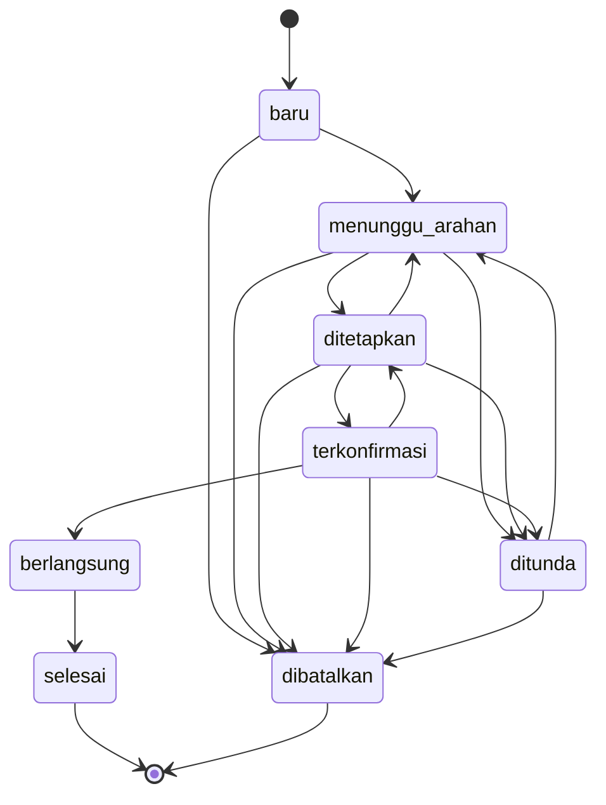

# Alur Proses dan Status Agenda (RK-06)

> **Dihasilkan otomatis** dari `packages/domain` oleh `scripts/buat-diagram-status.mjs` (`npm run docs:status`). **Jangan diedit tangan.** Aturan syarat tiap perpindahan: `docs/rekayasa/ATURAN_BISNIS.md`.

Alur utama (empat langkah, Rancangan 11.2): Baru → Menunggu Arahan → Ditetapkan → Terkonfirmasi.

| Dari | Boleh ke |
|---|---|
| Baru (`baru`) | Menunggu Arahan, Dibatalkan |
| Menunggu Arahan (`menunggu_arahan`) | Ditetapkan, Ditunda, Dibatalkan |
| Ditetapkan (`ditetapkan`) | Terkonfirmasi, Menunggu Arahan, Ditunda, Dibatalkan |
| Terkonfirmasi (`terkonfirmasi`) | Berlangsung, Ditetapkan, Ditunda, Dibatalkan |
| Berlangsung (`berlangsung`) | Selesai |
| Selesai (`selesai`) | (status akhir) |
| Dibatalkan (`dibatalkan`) | (status akhir) |
| Ditunda (`ditunda`) | Menunggu Arahan, Dibatalkan |
